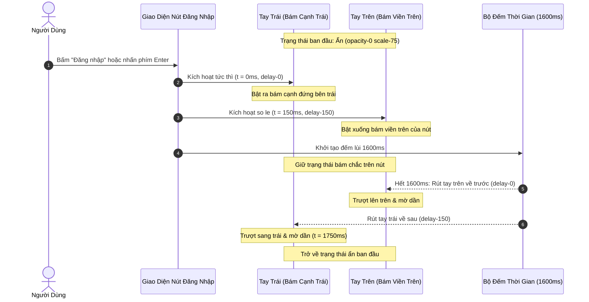

# 🐾 Tài Liệu Cập Nhật Giao Diện Màn Hình Đăng Nhập (Login Screen Specification)

> **Nhánh thực hiện**: `feat/login-screen`  
> **Thành phần chính**: `AuthDialog.tsx`  
> **Tài nguyên đồ họa**: Thư mục ảnh `images_login`  
> **Ngày cập nhật**: 18/11/2026  
> **Trạng thái**: Đã hoàn thiện, kiểm thử tự động đạt 214/214 tests, đóng gói build production sạch 0 lỗi.

---

## 🎯 1. Tổng Quan & Mục Tiêu Cải Tiến

Màn hình Đăng nhập (`AuthDialog.tsx`) là điểm chạm đầu tiên trong trải nghiệm định danh người dùng tại **Lubu Corp (Sutie Reader)**. Bản cập nhật này hướng tới 3 mục tiêu cốt lõi:

1. **Chuẩn hóa nhận diện thị giác (UI Design System Consistency)**:
   - Giữ vững ngôn ngữ thiết kế **Apple Minimalist Aesthetics**, hệ màu không gian **OKLCH**, font chữ **SF Pro Display**.
   - Bảo toàn bán kính bo góc chuẩn hệ thống `rounded-[8px]` trên nút hành động, đồng bộ với các trường nhập liệu (`Input`), thẻ truyện (`PostCard`) và khung hộp thoại (`Dialog`).

2. **Bổ sung tương tác sinh động (Micro-interactions)**:
   - Tích hợp minh họa hình ảnh đôi bàn tay mèo bám góc nút bấm khi người dùng thực hiện thao tác Đăng nhập.
   - Hoạt họa nảy lò xo (*Spring Easing*) với trình tự xuất hiện so le (*Staggered*) và chu trình tự động thu hồi đảo ngược mềm mại.

3. **Tối ưu hóa đa thiết bị (Responsive Execution)**:
   - Tỉ lệ hiển thị cân đối hoàn hảo trên cả màn hình di động nhỏ hẹp (Mobile `< 640px`) và máy tính để bàn (Desktop `≥ 640px`).

---

## 🎨 2. Quy Chuẩn Nút Bấm & Bố Cục Hộp Thoại

### 2.1. Quy cách Nút Đăng nhập (`Button`)
* **Bo góc**: `rounded-[8px]` (loại bỏ kiểu `rounded-full` để tránh xung đột với phong cách tối giản thanh lịch của dự án).
* **Kích thước**:
  * *Mobile*: Chiều cao `h-9` (36px), chữ `text-sm font-medium`.
  * *Desktop*: Chiều cao `sm:h-10` (40px), chữ `text-sm font-medium`.
* **Chiều rộng & Đổ bóng**: `w-full shadow-lg`, hiệu ứng tương phản cao trong cả Light Mode và Dark Mode.
* **Trạng thái Loading**: Khi đang gửi yêu cầu xác thực, nút hiển thị spinner quay vòng `Loader2` (`animate-spin w-5 h-5`).

### 2.2. Quy cách Khung Hộp Thoại (`DialogContent`) & Lớp Nền (`DialogOverlay`)
* **Độ co giãn**: `sm:max-w-md max-h-[90vh] sm:max-h-[85vh]`.
* **Khoảng cách lề (Padding)**: `p-4 sm:p-6`.
* **Thanh cuộn thông minh**: `overflow-y-auto overscroll-contain custom-scrollbar`.
* **Nền & Viền**: `bg-transparent border-0 ring-0 shadow-none` kết hợp cùng các lớp hiệu ứng nền toàn trang (Dot Matrix & Tech Grid).
* **Lớp phủ nền tương phản cao (`overlayClassName`)**: `bg-white/95 dark:bg-black/75 backdrop-blur-md`
  * *Light Mode*: Nền sáng trắng trang nhã, họa tiết caro tím và lưới công nghệ hiển thị nổi bật, chữ và các ô nhập liệu sắc nét tuyệt đối.
  * *Dark Mode*: Nền đen tuyền sâu thẳm nguyên bản.
* **Ô nhập liệu (`Input`)**: Áp dụng `bg-white/80 dark:bg-transparent shadow-xs` tạo khối trường nhập rõ nét, dễ đọc trên cả 2 giao diện.

### 2.3. Nút Chuyển Đổi Theme (`ThemeToggle`)
* **Vị trí**: Đặt tại góc trên bên phải màn hình thông qua cổng `topActions` (`fixed top-4 right-4 sm:top-5 sm:right-6 z-50`). Không đặt chen chúc trong khung form, giữ trọn vẹn sự cân đối và tập trung cho tiêu đề ở trung tâm.
* **Phong cách hiển thị (Không viền & Không nền hover - Pure Borderless)**: Sử dụng `variant="ghost"` và `border-0 ring-0 shadow-none bg-transparent hover:bg-transparent dark:hover:bg-transparent text-foreground cursor-pointer`, loại bỏ hoàn toàn viền và nền khi hover, chỉ giữ lại chuyển động xoay thanh thoát của biểu tượng Sun / Moon.
* **Cơ chế hoạt động**: Sử dụng `ThemeToggle` tích hợp hiệu ứng chuyển cảnh mặt nạ vòng tròn (*Circular Mask Transition* theo chuẩn Motion Prompt #017 qua View Transitions API), cho phép chuyển đổi tức thì giữa chế độ Sáng (Light Mode) và Tối (Dark Mode) mà không cần đóng hộp thoại.
* **Ngăn chặn lan truyền sự kiện**: Tích hợp `e.stopPropagation()` và khai báo `type="button"` rõ ràng nhằm tránh xung đột với sự kiện đóng modal hay submit form.

---

## 🐾 3. Kiến Trúc Minh Họa Đôi Bàn Tay Mèo (Cat Paws Architecture)

### 3.1. Danh mục Tài nguyên Đồ họa
* **`cat_foot.png` / `cat_foot_v2.png`**: Bộ ảnh gốc độ phân giải cao `1024x176` chứa đầy đủ 2 bàn chân mèo với đệm thịt hồng và viền nét sắc nét.
* **`cat_paw_left.png`**:
  * Độ phân giải: `190px x 255px`.
  * Xoay góc: **75° ngược chiều kim đồng hồ (CCW)**.
  * Vai trò: Mô phỏng bàn tay trái của chú mèo đang vươn từ bên sườn bám vào mép đứng bên trái nút.
* **`cat_paw_top.png`**:
  * Độ phân giải: `217px x 143px`.
  * Hướng: Nằm ngang tự nhiên.
  * Vai trò: Mô phỏng bàn tay phải vươn từ trên cao đặt lên mép ngang bên trên nút.

### 3.2. Giải phẫu học Tọa độ Bám Viền (Anatomy & Positioning)
Để tạo cảm giác hai bàn tay thuộc về cùng một chú mèo đang bám vào góc trên-bên trái của chiếc thẻ:

```
          [Bàn tay trên - cat_paw_top.png]
          (Móc sâu 7-8px qua mép trên)
                   vvvvvv
           ╭───▼▼▼▼▼───────────────────────────────────────╮
 [Bàn tay  │                                               │
  trái]    │                  ĐĂNG NHẬP                    │
   ►►►     │                                               │
(Móc sâu   ╰───────────────────────────────────────────────╯
 7-8px qua
 mép trái)
```

| Thành phần | Thuộc tính CSS (Mobile) | Thuộc tính CSS (Desktop `≥ 640px`) | Cơ chế hiển thị |
| :--- | :--- | :--- | :--- |
| **Bàn tay trái** (`cat_paw_left.png`) | `w-[22px] top-[1px] -left-[15px]` | `sm:w-[26px] sm:top-[2px] sm:-left-[18px]` | Bám cạnh đứng, móng vuốt và đệm phủ tràn 7–8px lên mặt nút. |
| **Bàn tay trên** (`cat_paw_top.png`) | `w-[34px] -top-[15px] left-[10px]` | `sm:w-[40px] sm:-top-[18px] sm:left-[12px]` | Bám viền trên, móng vuốt quắp xuống 7–8px phủ lên viền nút. |

* **Hiệu ứng chiều sâu**: Cả 2 bàn tay đều có lớp đổ bóng `drop-shadow-[0_2px_4px_rgba(0,0,0,0.3)]` với thứ tự hiển thị `z-10` đè lên mặt nút `Button`.
* **Ngăn chặn cản trở tương tác**: Thuộc tính `pointer-events-none select-none` đảm bảo người dùng nhấp chuột vào vị trí bàn tay thì sự kiện click vẫn truyền xuyên thẳng xuống nút Đăng nhập bên dưới.

---

## ⚡ 4. Kịch Bản Chuyển Động & Hoạt Họa (Animation & Timing)

### 4.1. Đường cong Gia tốc (Spring Easing)
Sử dụng hàm gia tốc lò xo vật lý:
```css
transition-all duration-300 ease-[cubic-bezier(0.34,1.56,0.64,1)]
```
Hàm số này giúp bàn tay khi vươn ra có độ nảy nhẹ (overshoot 156%) trước khi ổn định tại vị trí bám, tái hiện phản xạ tự nhiên của loài mèo.

### 4.2. Vòng đời Trình tự So le (Staggered Lifecycle)



### 4.3. Chi tiết các bước chuyển tiếp CSS

1. **Trạng thái Ẩn (`pawsActive === false`)**:
   * *Tay trái*: `opacity-0 -translate-x-3 sm:-translate-x-4 scale-75 delay-150`
   * *Tay trên*: `opacity-0 -translate-y-3 sm:-translate-y-4 scale-75 delay-0`
2. **Trạng thái Hiện (`pawsActive === true`)**:
   * *Tay trái*: `opacity-100 translate-x-0 scale-100 delay-0`
   * *Tay trên*: `opacity-100 translate-y-0 scale-100 delay-150`
3. **Phản hồi khi Rê Chuột (Hover effect)**:
   * Khi `pawsActive === true`, người dùng di chuột qua cụm nút:
     * Tay trái rướn nhẹ sang trái: `group-hover:-translate-x-0.5`.
     * Tay trên rướn nhẹ lên trên: `group-hover:-translate-y-0.5`.

### 4.4. Xử lý Ngoại lệ & Quản lý Bộ nhớ (Lifecycle & Edge Cases)
* **Tự động thu hồi khi lỗi**: Trong khối `catch` của `handleSubmit`, nếu API trả về lỗi xác thực, bàn tay được thiết lập thu hồi sau `800ms` (`setTimeout(() => setPawsActive(false), 800)`).
* **Reset khi người dùng thao tác form**: Khi người dùng đóng modal hoặc gọi hàm `resetState()`, cờ `pawsActive` lập tức trở về `false` và `clearTimeout(pawsTimerRef.current)` được gọi để tránh rò rỉ bộ nhớ.

---

## 📱 5. Bảng Thông Số Responsive Đa Thiết Bị

| Đặc tính / Phần tử | Mobile Viewport (< 640px) | Desktop Viewport (≥ 640px) |
| :--- | :--- | :--- |
| **Chiều cao Nút Đăng nhập** | `h-9` (36px) | `h-10` (40px) |
| **Cỡ chữ Nút Đăng nhập** | `text-sm` (14px) | `text-sm` (14px) |
| **Bán kính Bo góc Nút** | `rounded-[8px]` | `rounded-[8px]` |
| **Độ rộng Tay Trái** | `w-[22px]` | `w-[26px]` |
| **Tọa độ Tay Trái** | `top-[1px] -left-[15px]` | `top-[2px] -left-[18px]` |
| **Độ dịch ẩn Tay Trái** | `-translate-x-3` (-12px) | `-translate-x-4` (-16px) |
| **Độ rộng Tay Trên** | `w-[34px]` | `w-[40px]` |
| **Tọa độ Tay Trên** | `-top-[15px] left-[10px]` | `-top-[18px] left-[12px]` |
| **Độ dịch ẩn Tay Trên** | `-translate-y-3` (-12px) | `-translate-y-4` (-16px) |
| **Padding Khung Hộp Thoại** | `p-4` (16px) | `p-6` (24px) |
| **Chiều cao Khung Tối Đa** | `max-h-[90vh]` | `max-h-[85vh]` |

---

## 🛡️ 6. Tuân Thủ Quy Chuẩn Kiến Trúc & An Toàn

1. **Next.js 16.3.5 & React 19**:
   * Khai báo rõ ràng chỉ thị `'use client'` ở dòng đầu tiên của `AuthDialog.tsx`.
   * Sử dụng component `Image` của Next.js với thuộc tính `priority` để tải trước hình ảnh bàn tay, loại bỏ độ trễ hiển thị (FOUC).
2. **Quy tắc Routing & Middleware**:
   * Tuyệt đối không can thiệp hoặc tạo file `middleware.ts`, giữ nguyên cơ chế điều hướng proxy tại `src/proxy.ts`.
3. **Bảo mật Đăng nhập**:
   * Toàn bộ mật khẩu, mã xác thực OTP và mã PIN 6 số đều đi qua luồng mã hóa, xác minh phía máy chủ an toàn với cơ chế bảo vệ Brute-force.

---

## 🧪 7. Nghiệm Thu & Kiểm Thử Hệ Thống

Tuân thủ nghiêm ngặt quy trình kiểm thử tại `TESTING_MONITORING.md`:

* **Kiểm thử tự động (`npm test`)**:
  * Toàn bộ **214/214 bài kiểm thử** (bao gồm xác thực người dùng, bảo mật API, giải mã Canvas, quyền hạn) vượt qua 100%.
* **Kiểm thử đóng gói (`npm run build`)**:
  * Biên dịch bằng Next.js Turbopack hoàn tất sạch sẽ 0 lỗi TypeScript, 0 lỗi cảnh báo style.
